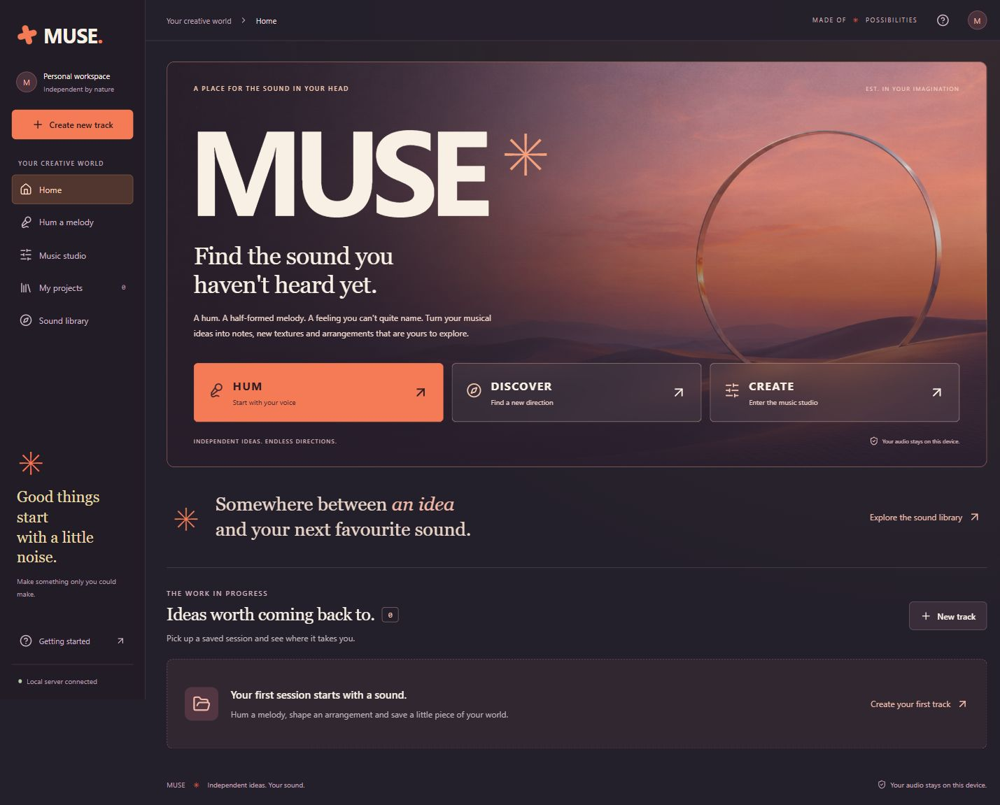
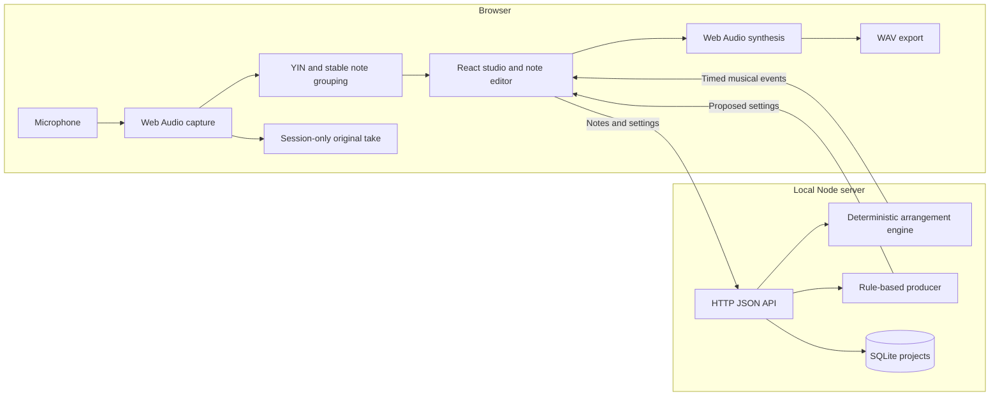

# MUSE

**Hum an idea. Shape its sound. Hear a composition that starts with you.**

**Creator and owner:** [liliesaredeadly](https://github.com/liliesaredeadly).

MUSE is a locally runnable music studio for people who have a melody in mind but do not know how to produce it. Record a short, single-voice melody, inspect and edit the detected notes, choose a mood and instrument, and play or export a synthesised arrangement.

The prototype combines real browser microphone capture, YIN pitch detection, a deterministic arrangement engine, and a Node.js/SQLite backend. Its producer assistant uses explicit musical rules. **No AI model, training pipeline, external music service, or API key is connected.**



## Run it

Requires **Node.js 22.13.0 or newer**, npm, and a browser with microphone and Web Audio support. Chrome or Edge can run the intended browser flow. Node's built-in SQLite may print an experimental-feature warning on Node 22.14; that warning does not indicate a failed database connection.

From Windows Command Prompt, open the project directory and run:

```cmd
node --version
npm install
npm run dev
```

Open **[http://localhost:5173](http://localhost:5173)**, or [http://127.0.0.1:5173](http://127.0.0.1:5173). Keep the terminal open. The development command runs both the Vite client on port `5173` and the Node backend on `127.0.0.1:3001`; Vite forwards `/api` requests to the backend. No environment file is required.

For the production build:

```cmd
npm run build
npm start
```

Then open **[http://127.0.0.1:3001](http://127.0.0.1:3001)**. The same Node process serves the built app and its API. Run `npm test` for the automated suite. `npm run preview` previews Vite's static build and is not the complete backend startup command.

Optional server settings are `PORT` and `MUSE_DB_PATH`. The default database is `data/muse.sqlite`. Changing the backend port during development also requires updating the proxy target in `vite.config.js`.

## Try the core flow

1. Select **CREATE** to enter the studio, or **HUM** for the focused recording view, then **Record your melody**. Allow microphone access and hum distinct, steady notes for 5–10 seconds.
2. Select **Finish take**. Review **Your melody**; select a note to raise or lower it by a semitone or remove it. The original take can be played during the current session.
3. Choose a mood, genre, lead instrument and tempo. Select **Create arrangement**, then play the composition.
4. Ask the producer, for example, **“Make it cinematic with strings at 100 BPM, add percussion.”** Review the proposal and select **Apply direction** to change the sound.
5. Rename the idea, select **Save project**, then reopen it from **My projects**. **Export WAV** renders the arrangement into an audio file.

There are no seeded melodies or fabricated microphone results. Silence or unclear input leaves the note timeline empty. The three-minute walkthrough is in [docs/DEMO.md](docs/DEMO.md).

## Architecture



Raw microphone audio stays in the browser. The server receives musical note data, settings, project titles and producer text. It returns arrangement events; the browser synthesises those events for playback and offline WAV rendering.

```text
src/
  audio/pitch.js          Monophonic YIN estimation and pitch conversion
  audio/recorder.js       Capture lifecycle, stable notes, pause and cleanup
  audio/synth.js          Instrument synthesis, transport and WAV rendering
  music/arrangement.js    Melody timing, approximate key/chords and backing
  producer/producer.js    Supported direction rules and reviewable proposals
  lib/api.js             Browser HTTP client and useful request failures
  lib/projects.js        Project defaults and validated browser-store adapter
  hooks/useStudio.js     Capture, editing, arrangement and save coordination
  components/            Studio, producer, waveform and editable timeline
server/
  app.js                 Routing, validation, body limits and static serving
  db.js                  SQLite schema and prepared project queries
  index.js               Loopback listener and shutdown handling
scripts/dev.mjs          Runs the Node server and Vite together
tests/                   Pitch, capture, arrangement, synth, store and HTTP tests
docs/DEMO.md             Three-minute presentation and recovery steps
DESIGN.md                Visual tokens, interaction and accessibility contract
```

### Backend engineering choices

- **SQLite persistence:** projects survive a server restart. Prepared statements and atomic upserts update a project without duplicating its identity or overwriting its original creation timestamp. WAL mode and a busy timeout support ordinary local access without an external database service.
- **Validation at the HTTP boundary:** invalid notes and settings receive clear JSON errors before reaching the musical engine. Request size, note count, timing and text lengths are bounded.
- **One musical implementation:** the server imports the same pure arrangement and producer modules that the unit tests exercise. Output is deterministic and can be explained and inspected.
- **Small runtime:** HTTP, SQLite and file serving use Node built-ins. No database server, hosted account or backend framework is needed for the demo.
- **A local default:** the process binds to `127.0.0.1`. Production static serving checks path containment, including resolved file paths, and supports SPA navigation without exposing files outside `dist/`.

The main UI saves to the Node database. `src/lib/projects.js` also provides a synchronous browser-storage adapter with corrupt-data recovery, a 30-project cap and explicit save failures; that adapter is tested independently and is not the UI's primary persistence path.

## HTTP API

The development backend is [http://127.0.0.1:3001](http://127.0.0.1:3001). Successful requests return `200`; POST bodies require `Content-Type: application/json`.

| Method | Route | Request | Response |
| --- | --- | --- | --- |
| GET | `/api/health` | — | `{ "ok": true, "storage": "sqlite" }` |
| GET | `/api/projects` | — | `{ "projects": [...] }`, most recently updated first |
| GET | `/api/projects/:id` | Safe project id | `{ "project": {...} }` |
| POST | `/api/projects` | Project document | `{ "project": {...} }`; creates or updates by id |
| POST | `/api/arrange` | `{ "notes": [...], "settings": {...} }` | `{ "arrangement": { "events": [...], "duration": ..., "bpm": ..., "key": ..., "chords": [...] } }` |
| POST | `/api/producer` | `{ "text": "...", "settings": {...} }` | `{ "message": "...", "changes": {...}, "suggestions": [...] }` |

Quick health check from Command Prompt:

```cmd
curl.exe http://127.0.0.1:3001/api/health
```

The following **PowerShell** example uses an explicitly synthetic, single-note API fixture to inspect the backend. It does not record a microphone, seed the app, or demonstrate recognition quality.

```powershell
$base = 'http://127.0.0.1:3001'
$settings = @{
  bpm = 90; sourceBpm = 90; instrument = 'Piano'
  mood = 'Dreamy'; genre = 'Ambient'
  accompaniment = $true; percussion = $false
}
$notes = @(@{ midi = 60; start = 0; duration = 0.5; confidence = 0.9 })
$body = @{ notes = $notes; settings = $settings } | ConvertTo-Json -Depth 6
Invoke-RestMethod -Uri "$base/api/arrange" -Method Post -ContentType 'application/json' -Body $body

$direction = @{ text = 'cinematic strings, no drums, tempo 110'; settings = $settings } | ConvertTo-Json -Depth 6
Invoke-RestMethod -Uri "$base/api/producer" -Method Post -ContentType 'application/json' -Body $direction
Invoke-RestMethod -Uri "$base/api/projects"
```

All errors use `{ "error": "Useful explanation" }`:

| Status | Meaning |
| --- | --- |
| `400` | Invalid JSON, invalid project/settings/notes, empty arrangement input or invalid producer text |
| `404` | Unknown route, missing project or missing static asset |
| `405` | Unsupported HTTP method; supported API methods are in the `Allow` header |
| `413` | Request body exceeds 256 KB |
| `415` | POST body is not sent as JSON |
| `500` | Unexpected local server or database failure; inspect the server terminal |

## Data, limits and privacy

Projects have this shape; the values below illustrate the schema:

```json
{
  "id": "safe-project-id",
  "title": "Evening idea",
  "notes": [{ "midi": 60, "name": "C4", "start": 0, "duration": 0.5, "confidence": 0.9 }],
  "settings": {
    "bpm": 90, "sourceBpm": 90, "instrument": "Piano",
    "mood": "Dreamy", "genre": "Ambient",
    "accompaniment": true, "percussion": false
  },
  "createdAt": "2026-11-17T10:00:00.000Z",
  "updatedAt": "2026-11-17T10:00:00.000Z"
}
```

- Recordings stop at **60 active seconds**. Paused time is excluded. Pitch analysis targets approximately **65–1400 Hz**, and stable notes need roughly 120 ms of consistent evidence.
- The API accepts at most **512 notes** per project. MIDI pitches are integers `0–127`; start times are finite and nonnegative; durations are finite and positive; each note must end within 600 seconds. Confidence is `0–1`, and expresses signal periodicity rather than a calibrated probability of correctness. Note names are derived from MIDI pitch.
- Tempo and source tempo are numeric **40–200 BPM**. Source tempo records the selected tempo when capture starts; the app does not infer a performer's actual tempo. Changing BPM scales the captured timing relative to that source tempo.
- Arrangements must also fit within **600 seconds after tempo scaling**. The API returns a useful `400` if a slowdown would exceed that limit, preserving the captured melody instead of silently dropping notes. A normal 60-second take slowed by the maximum 5× remains supported.
- Instruments: **Piano, Synthesizer, Strings, Bass, Drums**. Moods: **Dreamy, Cinematic, Melancholic, Energetic, Peaceful**. Genres: **Electronic, Ambient, Classical, Pop, Experimental**. Layer controls are booleans.
- IDs use 1–100 letters, numbers, underscores or hyphens. API titles contain 1–100 characters without control characters; the UI limits titles to 80. Dates use ISO timestamps, and the server owns the saved `updatedAt`. Producer API text is limited to 4,000 characters; the UI accepts 500.
- SQLite stores **notes, settings, title and timestamps** on this computer. It does not store the original take. Original audio is session-only and is unavailable after reopening a project. WAV export is generated audio downloaded by the user.
- There are no cloud uploads or account features. Local project files are ordinary, unencrypted files protected by the computer's filesystem permissions. `data/`, SQLite files and dependencies are excluded from version control. Back up `data/muse.sqlite` with the server stopped if you need to keep your projects elsewhere.

## Implemented and future scope

| Implemented in this MVP | Future work |
| --- | --- |
| Real single-voice microphone capture and approximate note detection | More robust transcription across voices, noise and expressive singing |
| Editable notes, tempo scaling, accompaniment and percussion | Detailed timing editing, richer harmony and multitrack arrangement |
| Synthesised instruments, playback transport and WAV export | Sample libraries, production effects and a fuller export workflow |
| Reviewable rule-based producer proposals | Optional model-backed musical assistance with explicit integration |
| Validated local HTTP API and restart-persistent SQLite projects | Accounts, collaboration, cloud sync and deployment hardening |

This is a monophonic prototype. It does not transcribe polyphonic songs or preserve the timbre of the recorded voice. Piano and strings are synthesised approximations. Key and chord labels are suggestions from a simple pitch/duration model. Selecting Drums adds percussion while a pitched synth retains the melody. The producer recognises supported words and directions; evocative requests outside those rules return supported examples.

## Verification — 2026-11-17

**Automated:** `npm test` completed with **67 tests passed, 0 failed** on Node 22.14. Coverage includes synthetic pitch fixtures and noise rejection; capture lifecycle and failure cleanup with controlled browser doubles; melody preservation and musical controls; transport and WAV/MIDI encoding; producer negation and audible piano backing; corrupt browser storage; and real HTTP requests against SQLite, including restart persistence, invalid input, body limits and static path containment.

**Browser checks:** all **10 integration checks passed** in the in-app Chromium browser. Real OfflineAudioContext rendered a non-silent WAV (RMS 0.02288); Piano and Strings produced different PCM samples; doubling BPM shortened the melody; and the actual recorder captured a generated C–E–G MediaStream with a 38,005-byte original recording. Permission refusal, cancellation with late permission completion, in-flight save edits and playback unlock races passed. Three additional checks use actual rendered components to edit notes, change instrument/tempo, apply producer proposals, play/pause/resume/stop, save/reopen, verify recording-state guards and navigate HUM/DISCOVER/CREATE. These are explicitly synthetic QA fixtures isolated from the product and real projects. Results are saved in [docs/verification/browser-results.json](docs/verification/browser-results.json).

**Interface checks:** desktop at 1440×1000 and mobile at 390×844; no mobile horizontal overflow; producer request/review/apply against the actual API; native instrument selection; keyboard BPM adjustment; guide focus and Escape dismissal; microphone-request cancellation. The production build passes. The strict static UI audit reports zero findings.

**Remaining device check:** a human humming into a physical microphone and subjective listening quality remain unverified. The in-app browser left the hardware permission request pending; its cancellation works. Perform the demo in Chrome or Edge, allow microphone access and test a short real hum before presenting. The WAV download dialog itself has not been exercised; WAV encoding and actual browser rendering have been verified.

To reproduce browser audio checks, run `npm run dev`, open [the developer checks](http://127.0.0.1:5173/tests/browser.html), select **Run browser checks**, and keep the tab active. This test page is not included in the production build. With the built application running, `npm run smoke` performs read-only HTTP checks against port 3001.

In the managed Codex workspace, sandboxed loopback connections can fail with `EACCES`. The successful HTTP test run used approved execution outside that sandbox. On a normal local terminal, `npm test` starts its own ephemeral loopback servers and temporary databases; the application server does not need to be running.

## Visual refinement

The interface uses an original desert-sunset illustration, warm editorial typography and a three-panel music workspace. **HUM** reuses the existing capture engine; **DISCOVER** applies editable presets using currently supported controls. Discovery cards are not prerecorded music or full genre-generation models. Audio file import is visibly marked as planned. The backend, API client, project state coordination, persistence and audio/music modules remain unchanged from the tested MVP.

## Troubleshooting

| Symptom | Action |
| --- | --- |
| `node:sqlite` cannot be imported | Check `node --version`; use Node 22.13 or newer. |
| “Server unavailable” or saving fails | Keep `npm run dev` running and check the backend's terminal. Open `/api/health` on port 3001. Starting only Vite does not start persistence or arranging. |
| Port 5173 or 3001 is already in use | Stop the older MUSE process using its terminal, then restart. If changing the backend port, update the Vite proxy too. |
| No microphone prompt or capture is blocked | Use localhost/127.0.0.1 or HTTPS, allow the site's microphone permission, and check Windows microphone privacy settings. Close other apps that have exclusive access to the device. |
| Empty or inaccurate notes | Use a quiet room, move closer to the microphone and hum one steady note at a time. Allow short gaps between notes. Avoid chords or background playback. Retry a short take and inspect the result. |
| Playback is silent | Press Play explicitly, check the browser/tab and system output volume, and confirm the selected output device. Recording and composition playback are mutually exclusive. |
| Original take disappeared after reopening | Expected: projects persist musical notes and settings; the original recording lasts only for the recording session. |
| Built app reports missing files | Run `npm run build` before `npm start`; open port 3001 for the complete production app. |
