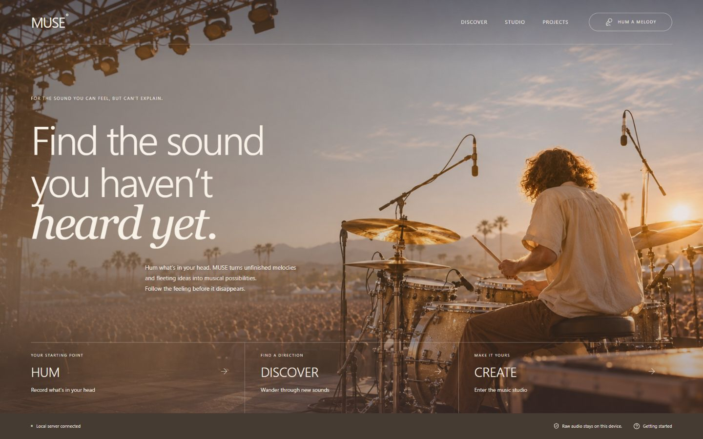
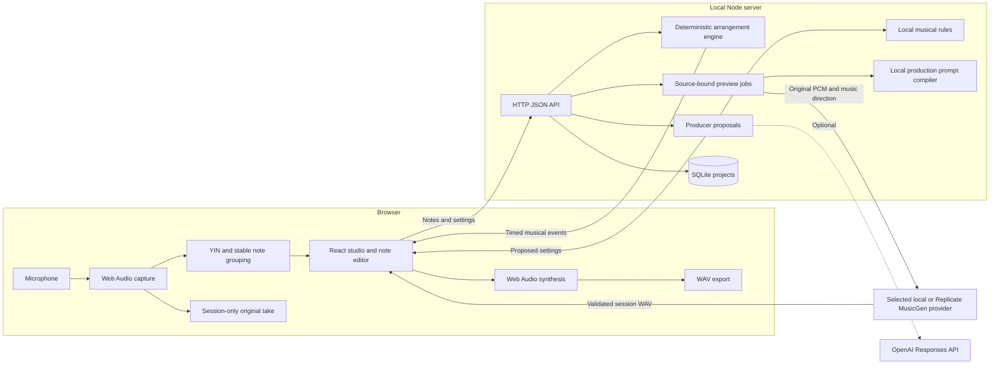

# MUSE

**Hum an idea. Shape its sound. Hear a composition that starts with you.**

**Creator and owner:** [liliesaredeadly](https://github.com/liliesaredeadly).

MUSE is a locally runnable music studio for people who have a melody in mind but do not know how to produce it. Record or import a short, single-voice melody and play the actual hum with synthesized backing. **Original hum** is selected for new takes. Instrumental reconstruction is an explicit alternative based on approximate detected notes.

The prototype combines real browser microphone capture, YIN pitch detection, a deterministic arrangement engine, and a Node.js/SQLite backend. Its **AI Production Director** uses musical rules by default, with an optional OpenAI connection for interpreting musical directions. Generate an editable blueprint, select guitar, piano, violin, cello, synth, bass or drums, adjust their roles, levels and section entries, then **Create my composition** or **Apply blueprint**. Individual backing variations can be regenerated while the original lead remains protected. Instrument sounds are synthesized approximations. No model is trained and no raw microphone audio is sent to OpenAI.

**Export detected melody MIDI** provides editable estimated notes and timing without changing your selected audible lead. MIDI cannot contain the original voice. Clear takes support estimated harmony. Sparse takes can support limited guitar, piano and strings only around independently confirmed harmonic anchors; other regions retain the original hum and requested drums. Takes without sufficient evidence still disable pitched backing. Saved projects retain the blueprint and notes, while original audio still requires reattachment after reopening.

## MusicGen previews

Optional hosted generation uses Replicate's melody-conditioned **MusicGen Melody Large**, alongside the existing local CPU option. Save `REPLICATE_API_TOKEN` only in your private `.env` and restart the backend; `MUSE_MELODY_PROVIDER=auto` selects the hosted provider when a token is configured. The preview panel discloses cloud upload and billing before its **Generate paid preview** action. See [hosted setup and verification limits](docs/MUSICGEN_REPLICATE.md). The hosted adapter is tested with simulated API responses; no paid hosted inference is claimed.

**Generate preview** is a separate neural interpretation of the actual hum and a compiled production direction. Genuine inference with the official `facebook/musicgen-melody` checkpoint is verified on this CPU machine: the real 7.62-second take produced a 4.94-second WAV from a five-second request in **305.666 seconds**. Five distinct synthetic melody/style cases also produced validated output with verified text, audio-feature projection and initial decoder conditioning. The original hum and protected composition remain available; neural previews may change melody, timing and instrumentation.

Use the [local setup guide](docs/MUSICGEN_LOCAL.md) for the isolated Python environment, approximately 6.23 GB of cached weights and `npm run dev:musicgen`. No paid API or OpenAI key is required for this path. Only the configured loopback service receives the recording; model assets download separately. The local [production knowledge library](docs/PRODUCER_KNOWLEDGE.md) documents prompt rules and references without artist imitation or song hooks.

CPU previews took minutes, not 20–40 seconds. Basic RMS/peak normalization is not professional mastering. The weights use **CC BY-NC 4.0**; this noncommercial demo does not establish a commercial deployment license. See [Meta's model card](https://huggingface.co/facebook/musicgen-melody) and the [verification report](docs/MUSICGEN_VERIFICATION.md) for measurements, recovered client timeouts, the rejected pre-fix trial and fidelity limits.

Latest automated verification: **464 Node tests and 48 Python tests passed**, and the production build passed. These checks accompany the actual local inference and native playback/download evidence; they do not establish exact neural melody fidelity or subjective production quality.



## Run it

Requires **Node.js 22.13.0 or newer**, npm, and a browser with microphone and Web Audio support. Chrome or Edge can run the intended browser flow. Node's built-in SQLite may print an experimental-feature warning on Node 22.14; that warning does not indicate a failed database connection.

From Windows Command Prompt, open the project directory and run:

```cmd
node --version
npm install
npm run dev
```

Open **[http://localhost:5173](http://localhost:5173)**, or [http://127.0.0.1:5173](http://127.0.0.1:5173). Keep the terminal open. The development command runs both the Vite client on port `5173` and the Node backend on `127.0.0.1:3001`; Vite forwards `/api` requests to the backend. No environment file is required.

For the production build:

```cmd
npm run build
npm start
```

Then open **[http://127.0.0.1:3001](http://127.0.0.1:3001)**. The same Node process serves the built app and its API. Run `npm test` for the automated suite. `npm run preview` previews Vite's static build and is not the complete backend startup command.

Optional server settings are `PORT` and `MUSE_DB_PATH`. The default database is `data/muse.sqlite`. Changing the backend port during development also requires updating the proxy target in `vite.config.js`.

### Optional OpenAI producer

The complete recording, arranging and saving flow works without an API key. To enable model-backed producer proposals locally:

1. In PowerShell, run `Copy-Item .env.example .env` from the project directory (`cp .env.example .env` on macOS/Linux).
2. Edit `.env` and set `OPENAI_API_KEY` to your own key. `OPENAI_MODEL` is optional; the default is `gpt-5.4-mini`. Overrides must support the Responses API, Structured Outputs and `reasoning.effort: none`.
3. Restart `npm run dev` (or `npm start` for the built app) and refresh the studio. The producer shows whether AI is configured. Check the source label on each proposal to see whether that response used AI or rules.

The server loads `.env`; the key stays on the server and is excluded from version control. Never put it in a `VITE_` variable, paste it into chat or add it to frontend code. OpenAI API access and billing are separate requirements; calls may incur charges. See the [OpenAI API quickstart](https://developers.openai.com/api/docs/quickstart) and [structured output documentation](https://developers.openai.com/api/docs/guides/structured-outputs).

When enabled, submitting a direction sends that instruction, supported musical settings and a bounded summary of detected MIDI notes to OpenAI. A missing key uses the existing rules. Provider errors, refusals, invalid output or an eight-second timeout fall back to rules with a notice. Remove or blank the key and restart the server to disable AI. A configured key does not establish that a live request has succeeded.

## Original pop production for the presentation

**Actual-hum repair:** original recording fidelity now takes priority over pitch guesses. New/imported takes use **Original hum** in the lead selector, preserving the full received audio clock through playback and WAV export. When transcription is unreliable, guessed chords/bass are withheld and requested rhythm stays beneath the voice. Style proposals keep this lead; selecting an instrument or editing a note explicitly uses approximate instrumental reconstruction. **Use a humming audio file** reattaches a saved original without recording again. Projects store settings/notes, not source audio: reattach the original after reopening, or export a WAV to keep the complete sound. See [actual-take repair evidence](docs/verification/actual-hum-repair-results.json).

After recording and checking **your own melody**, open **Shape this melody** and ask for **“Beauty and a Beat production”** (generic dance-pop) or **“Shape of You production”** (generic percussive pop). Review the proposal and choose **Create my composition**. These names select backing traits only: no song audio, hook, original chord sequence or reference match is needed. The source melody's pitches, timing and continuous contours remain protected. “Dance-pop production” and “percussive-pop production” work without artist names.

The two approaches add different grooves, pluck/pad articulation, bass and drum balance, stereo backing and phrase development. Fresh-input range, register, rhythmic density and phrase evidence guide the result. **Auto** uses the chosen genre; Ambient, Classical and Experimental remain available. Explicit solo/pair instrument and layer exclusions take priority. Backing BPM is independently editable; estimated humming tempo carries confidence and never forces the lead onto a grid.

This is a deterministic arrangement/synthesis upgrade. It is not trained on these songs, and it does not establish perfect recognition of arbitrary noisy recordings or commercial mastering quality. Its earlier [production tests and measured audio limits](docs/verification/original-pop-production-results.json) recorded 310 Node tests, 8 Python tests and 42 browser checks, including unfamiliar melodies and real rendered audio. Current MusicGen evidence and automated totals are recorded above.

## Optional local song reference

The HUM recorder and captured-take view include **Reference match**. When local reference features are available, record a varied 5–15 second phrase and select **Compare my hum**. A possible match links to the suggested passage in the original source. A weak or unsupported phrase returns a no-match explanation. This is experimental similarity matching against the local reference, not a verified song recognizer or a melody transcription; the composition continues to use your captured, editable notes.

The presentation machine has a local reference prepared from [Alan Walker's official “Alone” video](https://www.youtube.com/watch?v=1-xGerv5FOk). Reference audio and analysis files live in ignored `.local/reference-audio/`; they are not included in source control or the production build. Another checkout reports **Reference unavailable** until its own reference is prepared. The application does not download music automatically.

To analyze a locally supplied mono 16-bit PCM WAV, install NumPy in your Python environment and run:

```powershell
python scripts/analyze-reference.py input.wav .local/reference-audio/features.json --id my-reference --title "My reference" --artist "Creator" --source-url "https://www.youtube.com/watch?v=VIDEO_ID"
```

The preparation script computes spectral chroma, which loses octave and instrument information and cannot establish exact melody notes. The local library accepts HTTPS YouTube source attribution. The API exposes only reference metadata and comparison results through `GET /api/reference` and `POST /api/reference/match`; it does not serve the reference audio. Check preparation with `python -m unittest discover -s tests -p reference_analysis_test.py`. Browser state checks are available at `/tests/reference-browser.html` while running the development server. Real human-hum recognition against the mixed recording remains unverified until tested on the presentation device.

## Try the core flow

1. Select **HUM** on Home, or **HUM A MELODY** in the top navigation, then **Record your melody**. Allow microphone access and hum distinct, steady notes for 5–10 seconds.
2. Select **Finish take**. The cream captured-idea view shows the actual detected notes and phrase timing. Select a note to raise or lower it by a semitone or remove it. The original take can be played during the current session.
3. Select **Shape this melody**. In **Your creative direction**, enter **“Make it cinematic with strings at 100 BPM, add percussion.”** Submit with **Get producer recommendations**, then review the lavender proposal card and its source.
4. Select **Create my composition** to apply the proposal and arrange your melody. In the dark studio, play the composition, edit captured notes, and adjust mood, genre, lead instrument, tempo and layers. The studio's producer also offers an explicit **Apply direction** action.
5. Rename the idea, select **Save project**, then reopen it from **PROJECTS** in the top navigation. Select **Create arrangement** after reopening. **Export WAV** renders the arrangement into an audio file.

**CREATE** opens an empty studio for the manual workflow; **DISCOVER** applies editable sound presets before opening the studio. There are no seeded melodies, example tracks or fabricated microphone results. Silence or unclear input leaves the note timeline empty, and **PROJECTS** contains only saved user projects. The three-minute walkthrough is in [docs/DEMO.md](docs/DEMO.md).

## Architecture



The completed microphone recording is decoded to PCM WAV and sent to the local Node server for offline melody extraction. The server returns a SHA-256 receipt, notes, timing, rests, rhythm and continuous pitch contours, then checks that arranging preserves that melody. Audio conditioning is retained only in a bounded, temporary local cache; projects persist notes and contours. The browser renders the locked lead and generated backing. OpenAI receives settings and approximate notes only, never the raw recording. The separately configured local MusicGen Melody service uses actual audio for an explicitly requested neural preview, with source receipts and runtime conditioning checks before publishing its WAV. It does not replace the locked composition. See [the diagnosed pipeline and verification limits](docs/MELODY_PIPELINE.md).

```text
src/
  audio/pitch.js          Monophonic YIN estimation and pitch conversion
  audio/recorder.js       Capture lifecycle, stable notes, pause and cleanup
  audio/synth.js          Instrument synthesis, transport and WAV rendering
  music/arrangement.js    Melody timing, approximate key/chords and backing
  producer/producer.js    Supported direction rules and reviewable proposals
  lib/api.js             Browser HTTP client and useful request failures
  lib/projects.js        Project defaults and validated browser-store adapter
  hooks/useStudio.js     Capture, editing, arrangement and save coordination
  components/            Studio, producer, waveform and editable timeline
server/
  app.js                 Routing, validation, body limits and static serving
  db.js                  SQLite schema and prepared project queries
  index.js               Loopback listener and shutdown handling
  producer-brain.js      Optional OpenAI proposals and rules fallback
scripts/dev.mjs          Runs the Node server and Vite together
tests/                   Pitch, capture, arrangement, synth, store and HTTP tests
docs/DEMO.md             Three-minute presentation and recovery steps
DESIGN.md                Visual tokens, interaction and accessibility contract
```

### Backend engineering choices

- **SQLite persistence:** projects survive a server restart. Prepared statements and atomic upserts update a project without duplicating its identity or overwriting its original creation timestamp. WAL mode and a busy timeout support ordinary local access without an external database service.
- **Validation at the HTTP boundary:** invalid notes and settings receive clear JSON errors before reaching the musical engine. Request size, note count, timing and text lengths are bounded.
- **One musical implementation:** the server imports the same pure arrangement and rule-based producer modules that the unit tests exercise. Arrangements remain deterministic. The optional AI producer uses strict structured output and validates proposals against six existing controls: mood, instrument, genre, tempo, accompaniment and percussion.
- **Small runtime:** HTTP, SQLite, file serving and the optional OpenAI request use Node built-ins. No new dependency, database server, hosted account or backend framework is needed for the default demo.
- **A local default:** the process binds to `127.0.0.1`. Production static serving checks path containment, including resolved file paths, and supports SPA navigation without exposing files outside `dist/`.

The main UI saves to the Node database. `src/lib/projects.js` also provides a synchronous browser-storage adapter with corrupt-data recovery, a 30-project cap and explicit save failures; that adapter is tested independently and is not the UI's primary persistence path.

## HTTP API

The development backend is [http://127.0.0.1:3001](http://127.0.0.1:3001). Successful requests normally return `200`; generation submission returns `202`. POST JSON bodies require `Content-Type: application/json`.

| Method | Route | Request | Response |
| --- | --- | --- | --- |
| GET | `/api/health` | — | `{ "ok": true, "storage": "sqlite" }` |
| GET | `/api/projects` | — | `{ "projects": [...] }`, most recently updated first |
| GET | `/api/projects/:id` | Safe project id | `{ "project": {...} }` |
| POST | `/api/projects` | Project document | `{ "project": {...} }`; creates or updates by id |
| POST | `/api/arrange` | `{ "notes": [...], "settings": {...} }` | `{ "arrangement": { "events": [...], "duration": ..., "bpm": ..., "key": ..., "chords": [...] } }` |
| GET | `/api/producer/status` | — | Nonsecret producer configuration and mode; never the API key |
| POST | `/api/producer` | `{ "text": "...", "settings": {...}, "notes": [...] }`; notes optional | `{ "message": "...", "changes": {...}, "suggestions": [...], "source": "ai" or "rules" }`; fallback may include `notice` |
| GET | `/api/melody/model/status` | — | Live local model availability and job capabilities |
| POST | `/api/generation/jobs` | `{ "conditioningId": "...", "requestId": "...", "text": "...", "duration": 5, "settings": {...} }` | `202`, `{ "job": {...} }`; binds the original take and deduplicates the request ID |
| GET / DELETE | `/api/generation/jobs/:id` | Existing job ID | `{ "job": {...} }`; status or cancellation |
| GET | `/api/generation/jobs/:id/audio` | Successful job ID | Verified PCM WAV with source/output SHA headers; exact melody verification remains false |

Quick health check from Command Prompt:

```cmd
curl.exe http://127.0.0.1:3001/api/health
```

The following **PowerShell** example uses an explicitly synthetic, single-note API fixture to inspect the backend. It does not record a microphone, seed the app, or demonstrate recognition quality.

```powershell
$base = 'http://127.0.0.1:3001'
$settings = @{
  bpm = 90; sourceBpm = 90; instrument = 'Piano'
  mood = 'Dreamy'; genre = 'Ambient'
  accompaniment = $true; percussion = $false
}
$notes = @(@{ midi = 60; start = 0; duration = 0.5; confidence = 0.9 })
$body = @{ notes = $notes; settings = $settings } | ConvertTo-Json -Depth 6
Invoke-RestMethod -Uri "$base/api/arrange" -Method Post -ContentType 'application/json' -Body $body

$direction = @{ text = 'cinematic strings, no drums, tempo 110'; settings = $settings; notes = $notes } | ConvertTo-Json -Depth 6
Invoke-RestMethod -Uri "$base/api/producer/status"
Invoke-RestMethod -Uri "$base/api/producer" -Method Post -ContentType 'application/json' -Body $direction
Invoke-RestMethod -Uri "$base/api/projects"
```

All errors use `{ "error": "Useful explanation" }`:

| Status | Meaning |
| --- | --- |
| `400` | Invalid JSON, invalid project/settings/notes, empty arrangement input or invalid producer text |
| `404` | Unknown route, missing project or missing static asset |
| `405` | Unsupported HTTP method; supported API methods are in the `Allow` header |
| `413` | JSON exceeds 512 KB, or a recording exceeds the separate 16 MB audio limit |
| `415` | POST body is not sent as JSON |
| `500` | Unexpected local server or database failure; inspect the server terminal |

## Data, limits and privacy

Projects have this shape; the values below illustrate the schema:

```json
{
  "id": "safe-project-id",
  "title": "Evening idea",
  "notes": [{ "midi": 60, "name": "C4", "start": 0, "duration": 0.5, "confidence": 0.9 }],
  "settings": {
    "bpm": 90, "sourceBpm": 90, "instrument": "Piano",
    "mood": "Dreamy", "genre": "Ambient",
    "accompaniment": true, "percussion": false
  },
  "createdAt": "2026-11-17T10:00:00.000Z",
  "updatedAt": "2026-11-17T10:00:00.000Z"
}
```

- Recordings stop at **60 active seconds**. Paused time is excluded. Pitch analysis targets approximately **65–1400 Hz**, and stable notes need roughly 120 ms of consistent evidence.
- The API accepts at most **512 notes** per project. MIDI pitches are integers `0–127`; start times are finite and nonnegative; durations are finite and positive; each note must end within 600 seconds. Confidence is `0–1`, and expresses signal periodicity rather than a calibrated probability of correctness. Note names are derived from MIDI pitch.
- Tempo and source tempo are numeric **40–200 BPM**. Source tempo records the selected tempo when capture starts; the app does not infer a performer's actual tempo. Changing BPM scales the captured timing relative to that source tempo.
- Arrangements must also fit within **600 seconds after tempo scaling**. The API returns a useful `400` if a slowdown would exceed that limit, preserving the captured melody instead of silently dropping notes. A normal 60-second take slowed by the maximum 5× remains supported.
- Instruments: **Piano, Synthesizer, Strings, Bass, Drums**. Moods: **Dreamy, Cinematic, Melancholic, Energetic, Peaceful**. Genres: **Electronic, Ambient, Classical, Pop, Experimental**. Layer controls are booleans.
- IDs use 1–100 letters, numbers, underscores or hyphens. API titles contain 1–100 characters without control characters; the UI limits titles to 80. Dates use ISO timestamps, and the server owns the saved `updatedAt`. Producer API text is limited to 4,000 characters; the UI accepts 500.
- SQLite stores **notes, settings, title and timestamps** on this computer. It does not store the original take. Original audio is session-only and is unavailable after reopening a project. WAV export is generated audio downloaded by the user.
- By default there are no external uploads. Enabling the OpenAI producer sends submitted directions, musical settings and a bounded detected-note summary to OpenAI; it does not send raw audio or upload saved projects. There are no MUSE account or cloud-sync features. Local project files are ordinary, unencrypted files protected by the computer's filesystem permissions. `.env`, `data/`, SQLite files and dependencies are excluded from version control. Back up `data/muse.sqlite` with the server stopped if you need to keep your projects elsewhere.

## Implemented and future scope

| Implemented in this MVP | Future work |
| --- | --- |
| Real single-voice microphone capture and approximate note detection | More robust transcription across voices, noise and expressive singing |
| Editable notes, tempo scaling, accompaniment and percussion | Detailed timing editing, richer harmony and multitrack arrangement |
| Synthesised instruments, playback transport and WAV export | Sample libraries, production effects and a fuller export workflow |
| Reviewable producer proposals from local rules or optional OpenAI | Richer musical controls and deeper arrangement assistance |
| Validated local HTTP API and restart-persistent SQLite projects | Accounts, collaboration, cloud sync and deployment hardening |

This is a monophonic prototype. It does not transcribe polyphonic songs. Original-hum mode retains the recorded voice; instrumental reconstruction uses synthesised approximations and estimated notes. Key and chord labels are suggestions from a simple pitch/duration model. The rules producer recognises supported words and directions, while optional OpenAI interprets wording into supported controls and blueprints. These producer proposals do not generate audio or improve pitch detection. The separate local MusicGen preview performs learned audio generation and may alter the melody.

## Historical verification — 2026-11-18

The dated records below preserve observations from those earlier stages. Current MusicGen inference, automated totals and native WAV playback/download evidence are documented in [MUSICGEN_VERIFICATION.md](docs/MUSICGEN_VERIFICATION.md); earlier statements that those checks were pending are historical.

**Automated:** `npm test` completed with **126 tests passed, 0 failed** on Node 22.14. Coverage includes synthetic pitch fixtures and noise rejection; capture lifecycle and cleanup; melody preservation and musical controls; transport and WAV/MIDI encoding; producer rules; corrupt browser storage; and real HTTP/SQLite checks for restart persistence, validation, body limits and static containment. Adapter checks cover successful mocked AI, strict output validation, refusals, provider failures, timeouts, concurrency, request privacy and safe fallback tempos. A real HTTP check applies a long-take fallback and successfully arranges the preserved melody. Results: [video-reference-tests.txt](docs/verification/video-reference-tests.txt).

**Optional AI verification:** provider calls were mocked; no real API key was supplied, so a live OpenAI request remains unverified. Test doubles cannot establish account access, billing, model availability, latency or real response quality.

**Browser checks:** all **16 integration checks passed** in the in-app Chromium browser. Checks cover real OfflineAudioContext WAV rendering, distinct instrument/tempo samples, synthetic C–E–G capture through the actual recorder, permission/save/transport races, rendered note edits, explicit producer Apply, save/reopen and navigation. Producer checks cover AI configuration versus actual source, detected-note context, fallback notices, stale and overlapping proposals, loading, unavailable status and a server-mode change after a cached rules status. The reference flow also covers HUM capture, **Shape this melody**, explicit **Create my composition**, composition playback and saving. These are synthetic QA fixtures with an isolated API double; no real projects are saved. Results: [video-reference-browser-results.json](docs/verification/video-reference-browser-results.json).

**Interface checks:** desktop at 1440×1000 and mobile at 390×844, with no mobile horizontal overflow. The full reference-inspired flow uses top navigation, a photographic Home and HUM page, cream captured-analysis and direction pages, a lavender proposal card, and a dark composition workspace. Keyboard focus and the guide's Escape dismissal work. The production build and read-only HTTP smoke check pass; the strict static UI audit reports zero findings. [Home preview](docs/verification/video-reference-home.jpg), [HUM preview](docs/verification/video-reference-hum.jpg), [empty studio preview](docs/verification/video-reference-studio.jpg). The screenshots do not represent a human-recorded composition.

**Remaining device check:** a human humming into a physical microphone and subjective listening quality remain unverified. The in-app browser left the hardware permission request pending; its cancellation works. Perform the demo in Chrome or Edge, allow microphone access and test a short real hum before presenting. The WAV download dialog itself has not been exercised; WAV encoding and actual browser rendering have been verified.

To reproduce browser audio checks, run `npm run dev`, open [the developer checks](http://127.0.0.1:5173/tests/browser.html), select **Run browser checks**, and keep the tab active. This test page is not included in the production build. With the built application running, `npm run smoke` performs read-only HTTP checks against port 3001.

In the managed Codex workspace, sandboxed loopback connections can fail with `EACCES`. The successful HTTP test run used approved execution outside that sandbox. On a normal local terminal, `npm test` starts its own ephemeral loopback servers and temporary databases; the application server does not need to be running.

### Reliability pass — 2026-11-18

Fixed stale same-project reopening, preservation of dirty empty melodies, and successful saves depending on a second library request. Interrupted encoders now retain their final audio chunks and return the capture to idle. Producer exclusions cancel matching earlier proposals; “remove drums” also removes a Drums lead's implied rhythm. The percussion control now visibly reflects rhythm included by the Drums lead.

Final verification: **130 automated tests passed**, **21 browser integration checks passed**, production build passed, read-only HTTP smoke passed, and strict UI audit reported zero findings. New browser regressions cover same-project reopening, saving empty melodies, switching away after note deletion, saving without a library refresh, and the Drums percussion control. Narrow studio inspection at 390×844 had no horizontal overflow; guide Escape dismissal restored focus. Evidence: [automated results](docs/verification/bugfix-tests.txt), [browser summary](docs/verification/bugfix-browser-results.json), [static audit](docs/verification/bugfix-ui-audit.json).

One browser run during parallel build/test load missed the first synthetic capture note. An isolated rerun passed 20/20; after the percussion-control fix, the final isolated run passed 21/21. This does not establish capture reliability under heavy browser load. A physical microphone, subjective listening quality and live OpenAI remain unverified.

### Microphone and interface refinement — 2026-11-18

Microphone capture now identifies the active device and displays its measured input level. A zero-note take keeps a persistent explanation, original playback and a local original-audio download. Quiet and breathy periodic signals receive noise conditioning before YIN; the 0.85 periodicity requirement and 65–1400 Hz range remain unchanged. Note grouping tolerates brief missed frames and small tuning wobble, while missed analysis intervals cannot become invented held notes. Pitch editing supports the API's full MIDI 0–127 range, disables unavailable edits and restores keyboard focus after deletion.

The interface retains its photographic, cream, lavender and dark identity. Studio controls share a consistent height, touch controls have larger targets, mobile navigation stays readable, narrow action rows wrap, selected notes retain contrast on the cream HUM screen, and the scrollbar gutter prevents horizontal shifts between pages.

Verification: **144 automated tests passed**, **25 browser checks passed**, production build and read-only HTTP smoke passed, and strict UI audit reported zero findings. Home, Discover, Projects, HUM and Studio had no horizontal overflow at 320px and 390px. The direction page was also checked with a real local-rules proposal at 320px; the guide dismissed with Escape and restored focus from that cream screen. Evidence: [automated results](docs/verification/mic-ui-tests.txt), [browser summary](docs/verification/mic-ui-browser-results.json), [static audit](docs/verification/mic-ui-audit.json).

The existing private 9.3-second microphone take improves from zero grouped notes to two short D4 segments; it still does not establish sustained real-world melody recognition. Generated regression signals are not a substitute for a fresh physical-microphone retest. Private audio copies stay outside tracked source, including ignored `.local` diagnostics; no private recording is included in the test fixtures. Live AI setup is deferred.

### Atelier interface — 2026-11-19

The current visual direction for **Studio, HUM, producer direction and Projects** interprets [Saint Laurent](https://www.ysl.com/en-us) restraint and [PUMA](https://us.puma.com/us/en) typographic weight: ink/ivory surfaces, condensed uppercase headings, square controls and monochrome record sleeves. HUM applies grayscale to its own photograph layer. **Home and Discover are explicitly protected and unchanged**, including their existing shared assets and styles.

The new treatment lives in three page-scoped `atelier*.css` modules loaded after the reference foundation. It changes no backend, audio, persistence or proposal behavior and adds no production dependency. Existing original-take playback, input feedback, note editing, Save and Export remain available. Gallery screenshots use clearly named, isolated QA fixtures, not seeded product projects.

Validation: **144 automated tests**, **25 isolated Chrome browser checks**, desktop and 390px/320px layout checks, plus protected-page screenshot comparisons at 1440px, 390px and 320px. Home and Discover are pixel-identical when the three Atelier stylesheets are disabled and enabled on the same page. Protected source and asset hashes also remain identical. Results: [automated tests](docs/verification/atelier-tests.txt), [browser/render checks](docs/verification/atelier-browser-results.json), [UI audit](docs/verification/atelier-ui-audit.json). Previews: [HUM](docs/verification/atelier-hum-desktop.png), [empty Studio](docs/verification/atelier-studio-empty-desktop.png), [direction](docs/verification/atelier-direction-desktop.png). These previews do not demonstrate a physical-microphone performance or live AI response.

## Visual refinement

Home and Discover retain the supplied video-reference design, including the golden-hour drummer photograph and **MUSE / DISCOVER / STUDIO / PROJECTS** navigation. The other screens use the Atelier treatment described above. **HUM** moves from a monochrome photo-backed recorder to ivory analysis of the actual take; **Shape this melody** opens the ivory producer page and black proposal panel. **Create my composition** explicitly applies the reviewed direction and opens the dark, full-width editor, whose tracks come from actual arrangement events. **CREATE** retains the manual empty-studio route. **DISCOVER** applies editable synthesis presets; its cards are not prerecorded music or full genre-generation models. Project artwork uses real saved metadata, and the library has no seeded examples. Optional AI extends producer proposals; capture, arrangement, synthesis and SQLite persistence retain their existing roles.

## Troubleshooting

| Symptom | Action |
| --- | --- |
| `node:sqlite` cannot be imported | Check `node --version`; use Node 22.13 or newer. |
| “Server unavailable” or saving fails | Keep `npm run dev` running and check the backend's terminal. Open `/api/health` on port 3001. Starting only Vite does not start persistence or arranging. |
| Port 5173 or 3001 is already in use | Stop the older MUSE process using its terminal, then restart. If changing the backend port, update the Vite proxy too. |
| No microphone prompt or capture is blocked | Use localhost/127.0.0.1 or HTTPS, allow the site's microphone permission, and check Windows microphone privacy settings. Close other apps that have exclusive access to the device. |
| Empty or inaccurate notes | Use a quiet room, move closer to the microphone and hum one steady note at a time. Allow short gaps between notes. Avoid chords or background playback. Retry a short take and inspect the result. |
| Playback is silent | Press Play explicitly, check the browser/tab and system output volume, and confirm the selected output device. Recording and composition playback are mutually exclusive. |
| Original take disappeared after reopening | Expected: projects persist musical notes and settings; the original recording lasts only for the recording session. |
| AI stays disabled after adding a key | Set `OPENAI_API_KEY` in the project-root `.env` and restart the Node server. Check `/api/producer/status`; never expose the key to diagnose it. |
| AI is configured but a proposal says rules | Read the fallback notice. Check server configuration and your API account's access/billing. The rules proposal remains reviewable and can be applied. |
| Built app reports missing files | Run `npm run build` before `npm start`; open port 3001 for the complete production app. |
